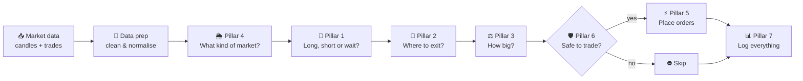
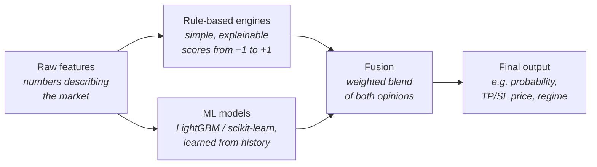
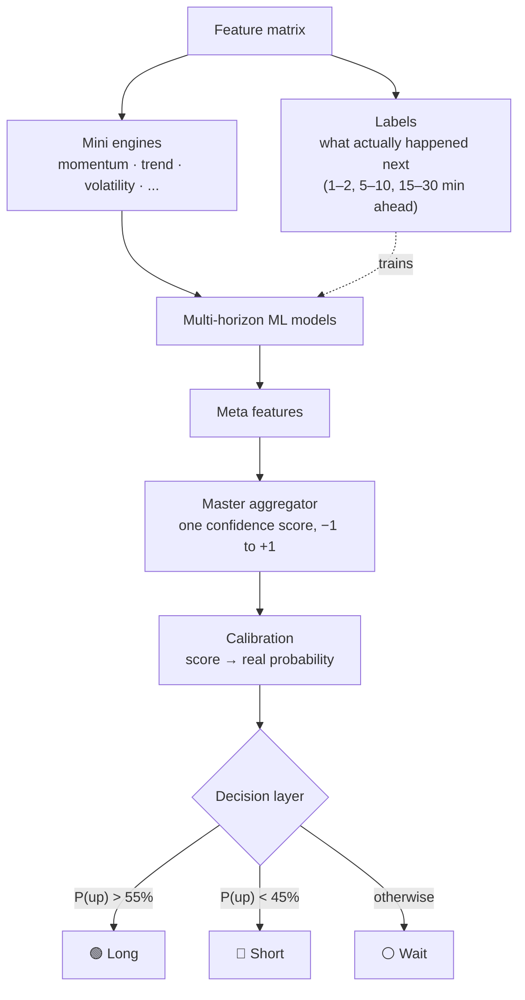
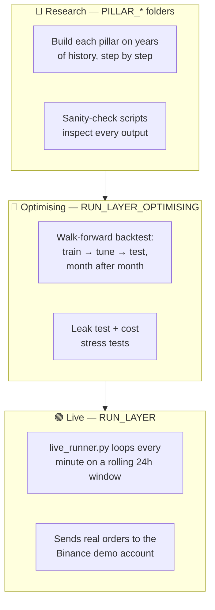
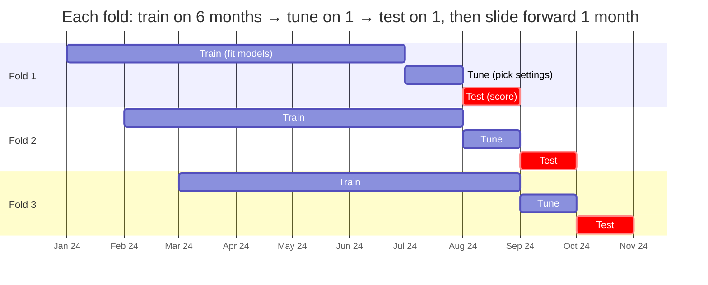
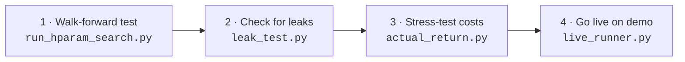

# Seven-Pillar Bitcoin Trading Bot

An automated trading system for **Bitcoin perpetual futures (BTCUSDT) on Binance**.

Each job a human trader does is handled by its own part of the system, called a **pillar**. Every minute, the pillars pass the decision along a production line, from "what is the market doing?" to "place the order". Any pillar can stop the trade on the way.

> ⚠️ **Research project, not financial advice.** It's built for and tested on the **Binance demo (testnet) account**. Don't point it at real money unless you understand every line.

---

## Contents

1. [The idea in one picture](#1-the-idea-in-one-picture)
2. [The seven pillars](#2-the-seven-pillars)
3. [How a single pillar thinks](#3-how-a-single-pillar-thinks)
4. [Three ways to run the code](#4-three-ways-to-run-the-code)
5. [Honest testing: walk-forward validation](#5-honest-testing-walk-forward-validation)
6. [Folder structure](#6-folder-structure)
7. [Getting started](#7-getting-started)
8. [Tech stack](#8-tech-stack)

---

## 1. The idea in one picture

Once a minute, when a new 1-minute candle closes, the bot runs this loop:



Each pillar does **one job** and hands a clear result to the next. Any of them can say *"no trade"*, so a weak or risky idea gets filtered out before it costs money.

---

## 2. The seven pillars

Pillar numbers are fixed names, not the order they run in. Pillar 4 runs first because the others need its answer.

| # | Pillar | Question it answers | Plain-English job |
|---|--------|--------------------|-------------------|
| – | **Data prep** (`PRE_PILLARFOUR`) | *Is the data clean and comparable?* | Merges price candles, trade flow and higher timeframes (5m → 1d) into one table. Rescales everything so the numbers can be compared fairly. |
| 4 | **Regime detection** | *What kind of market is this?* | Labels the market as trending, choppy, volatile, quiet, liquid or illiquid. The labels are kept steady so they don't flip every minute. |
| 1 | **Entry model** | *Should I go long, short, or wait?* | Scores momentum, trend and volatility, runs ML models over several time horizons, and turns the result into a probability. If it's confident enough, it trades. Otherwise it waits. |
| 2 | **Exit model** | *Where do I take profit and cut losses?* | Picks a take-profit and stop-loss price that fit current conditions, plus the chance of hitting the profit target first. |
| 3 | **Risk model** | *How big should this trade be?* | Sizes the trade so hitting the stop-loss only loses a small, fixed amount. Shrinks size and leverage in wild or thin markets, and applies hard caps. |
| 6 | **Safety layer** | *Is it actually safe right now?* | The bouncer. It can block any trade, makes sure open trades always have protective orders, and has a **kill switch** that closes everything. |
| 5 | **Execution engine** | *How do I get filled without overpaying?* | Talks to Binance. It tries cheaper limit orders first and escalates step by step. It only adds take-profit and stop-loss orders once the entry has filled, and cancels the other when one hits. |
| 7 | **Monitoring** | *What happened, and is it working?* | Logs every event, builds a trade ledger with profit after fees, works out win rate and profit factor, and can replay any single trade. |

---

## 3. How a single pillar thinks

Pillars 1, 2 and 4 all use the same recipe. Each one combines **simple hand-written rules** with **machine learning**, then blends the two. Neither one gets the final say alone.



Why both?
- **The rules** are easy to understand and don't break in odd ways.
- **The ML** spots patterns the rules miss.
- **The blend** means one bad input can't sink the decision.

**Pillar 1 in detail:**



---

## 4. Three ways to run the code

Most pillar code exists in more than one place, because it's used in three different modes:



| Mode | Where | What it's for |
|------|-------|---------------|
| **Research** | `PILLAR_*/`, `PRE_PILLARFOUR/` | Building and understanding each pillar on its own, using lots of historical data. |
| **Optimising** | `RUN_LAYER_OPTIMISING/` | Testing whether the whole system has an edge, using data it has never seen. |
| **Live** | `RUN_LAYER/` | Running the bot for real, against the demo exchange. The `*_LIVE` folders are versions of the pillars adapted to work on a rolling window. |

---

## 5. Honest testing: walk-forward validation

Fooling yourself with a backtest is easy. You tune settings until the past looks great, but the bot never saw a "future". This project avoids that with **walk-forward validation**:



The rules it follows:
- **Test months stay hidden.** Settings are chosen on the *tune* month only. The *test* month is scored once at the end.
- **Each fold starts fresh.** All generated data is wiped between folds, so nothing carries over.
- **Results are realistic.** Trades are replayed candle by candle with fees and slippage. If the take-profit and stop-loss both fall inside the same candle, it **assumes the loss**.
- **There's a leak test.** [`leak_test.py`](RUN_LAYER_OPTIMISING/scripts/leak_test.py) recalculates features using *only* data up to each moment and checks they match. If they don't, the model was secretly seeing the future.
- **Costs get stress-tested.** [`actual_return.py`](RUN_LAYER_OPTIMISING/scripts/actual_return.py) re-runs results with extra slippage and fees, to see if any edge survives.

---

## 6. Folder structure

```text
.
├── PRE_PILLARFOUR/                 Data prep: merge raw data + normalise features
│   ├── build_canonical_raw.py          merge candles, delta, microstructure, higher timeframes
│   ├── build_canonical_with_engines.py add session / volatility / HTF engine features
│   ├── global_scaling_engine.py        z-score / MAD / clipping normalisation
│   └── global_engines/                 shared feature engines
│
├── PILLAR_FOUR_REGIME_DETECTION/   Pillar 4: what kind of market is this?
│   ├── dataMakers/                     download + build raw data (candles, delta, microstructure)
│   ├── dataCheckers/                   sanity checks for that raw data
│   └── src/
│       ├── engines/                    trend, volatility, liquidity, chop, mean-reversion
│       ├── part_three/                 ML regime classifier
│       ├── part_four/                  fusion (rules + ML)
│       ├── part_five/                  stability (stop labels flickering)
│       └── part_seven/                 RegimeMasterAPI: one combined regime timeline
│
├── PILLAR_ONE_ENTRY_MODEL/         Pillar 1: long, short or wait?
│   └── src/
│       ├── engines/  features/  labels/  models/   the building blocks
│       ├── pipeline/                   build_* scripts run them in order
│       └── research/                   analysis scripts
│
├── PILLAR_TWO_EXIT_MODEL/          Pillar 2: take-profit and stop-loss levels
│   └── src/
│       ├── exit/                       building blocks (features → rules → ML → fusion → targets)
│       ├── pipeline/                   build_* scripts
│       └── research/                   sanity checks + simple backtests
│
├── PILLAR_THREE_RISK_MODEL/        Pillar 3: position size + leverage
├── PILLAR_FIVE_EXECUTION_ENGINE/   Pillar 5: order placement on Binance
├── PILLAR_SIX_SAFETY_LAYER/        Pillar 6: vetoes, guards, kill switch
├── PILLAR_SEVEN_MONITORING/        Pillar 7: event log, trade ledger, metrics
│
├── RUN_LAYER/                      🟢 Live trading
│   └── src/
│       ├── live_runner.py              ← the main entry point for live mode
│       ├── fetch_candles.py, delta_and_micro.py, rollups.py, trade_aggregator.py
│       └── *_LIVE/                     rolling-window versions of each pillar
│
├── RUN_LAYER_OPTIMISING/           🧪 Walk-forward testing
│   ├── scripts/
│   │   ├── run_hparam_search.py        ← the main entry point for backtesting
│   │   ├── leak_test.py                checks for look-ahead leakage
│   │   └── actual_return.py            cost / slippage stress test
│   └── src/                            offline data fetcher + optimiser copies of pillars
│
├── requirements.txt
├── .env.example                    template for API keys (copy to .env)
└── .gitignore
```

> No data, trained models or results are included. They're all **generated** when you run the pipeline and are ignored by git.

---

## 7. Getting started

### 7.1 Install

```bash
git clone <this-repo-url>
cd <repo-folder>
python3.11 -m venv venv
source venv/bin/activate
pip install -r requirements.txt
```

### 7.2 Add your API keys (demo only)

1. Create **demo** API keys at [demo.binance.com](https://demo.binance.com).
2. Copy the template into each folder that reads keys:

```bash
cp .env.example PILLAR_THREE_RISK_MODEL/src/pipeline/.env
cp .env.example PILLAR_FIVE_EXECUTION_ENGINE/src/execution/.env
cp .env.example PILLAR_SIX_SAFETY_LAYER/src/safety/.env
```

3. Fill in `BINANCE_FUTURES_API_KEY` and `BINANCE_FUTURES_API_SECRET` in each file.

`.env` files are in `.gitignore`, so they never get committed.

### 7.3 Run it

The usual order is **backtest first, live second**:



```bash
# 1. Walk-forward backtest (downloads history from data.binance.vision, trains, tunes, tests)
python RUN_LAYER_OPTIMISING/scripts/run_hparam_search.py

# 2. Leak test on one fold (see the script's header for all options)
python RUN_LAYER_OPTIMISING/scripts/leak_test.py --fold-cache RUN_LAYER_OPTIMISING/data/cache/<fold_id> --window test

# 3. Cost stress test on the backtest's trades
python RUN_LAYER_OPTIMISING/scripts/actual_return.py

# 4. Live loop against the Binance demo account (runs until you stop it)
python RUN_LAYER/src/live_runner.py
```

To explore a single pillar in research mode, run its `build_*` scripts in order. Every script explains at the top what it reads and writes. The `research/` and `dataCheckers/` scripts print PASS/FAIL checks on each step's output.

> 💾 **Memory note:** a few months of tick-level trade data is very large. The offline fetcher limits the trade sample so it doesn't crash an 8 GB machine.

---

## 8. Tech stack

| Area | Tools |
|------|-------|
| Language | Python 3.11 |
| Data | pandas, polars, NumPy, PyArrow (Parquet), DuckDB |
| Machine learning | LightGBM, scikit-learn (calibration, classifiers), joblib |
| Exchange | Binance USDⓈ-M Futures REST + websockets (`requests`, `websockets`) |
| Config | python-dotenv |
| Charts | matplotlib |

---

## Disclaimer

This code is for education and research. Trading leveraged crypto futures is very risky, and past or simulated performance doesn't guarantee future results. Use at your own risk.
